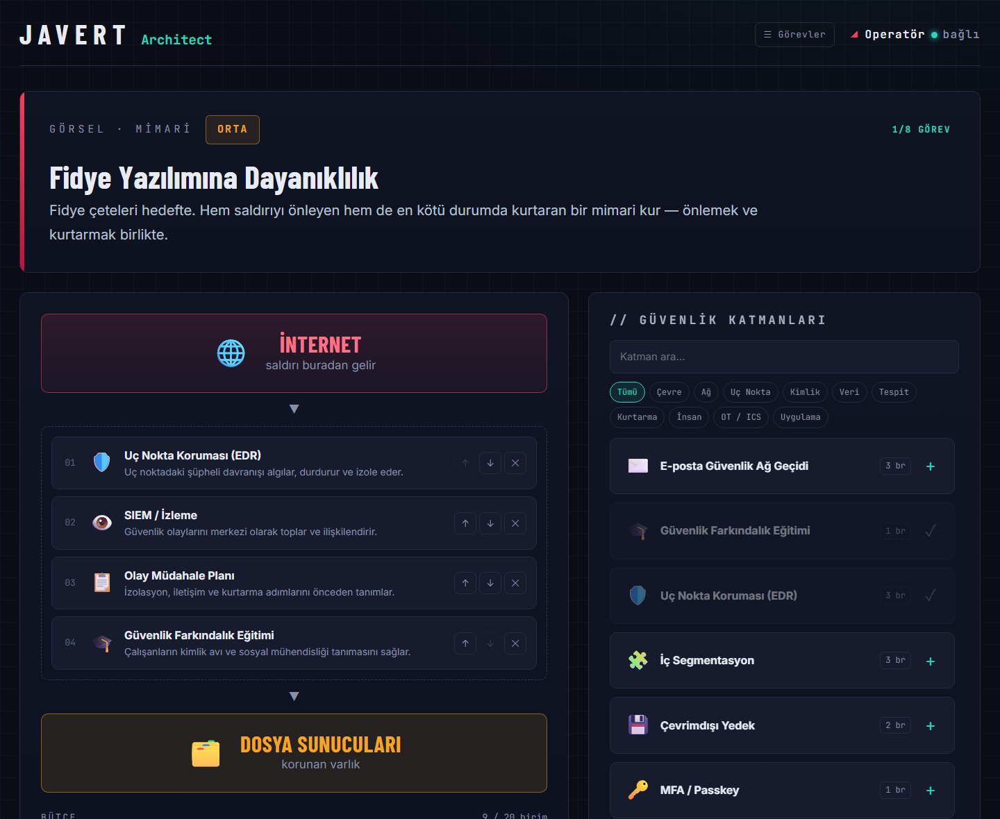
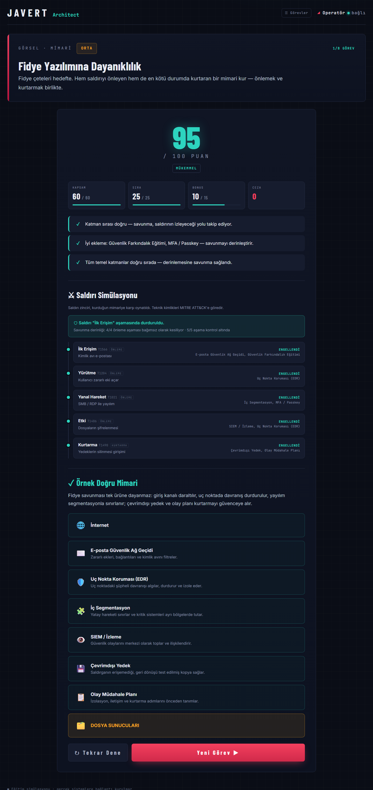
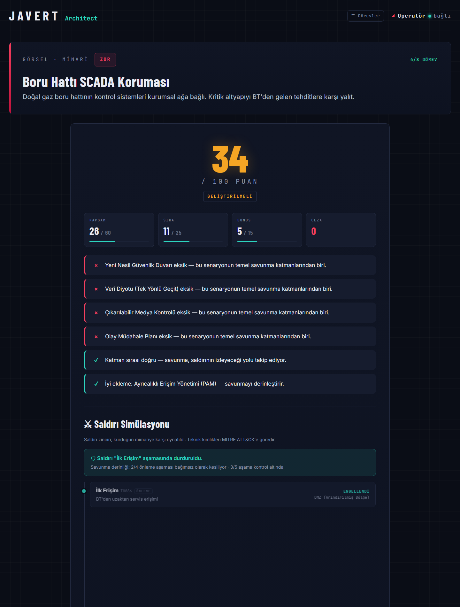

<div align="center">

# 🛡️ JAVERT Architect

**Derinlemesine savunma mimarisi kurma ve saldırı simülasyonu ile siber güvenlik eğitim oyunu**

Saldırının geldiği kaynak ile korunan varlık arasına güvenlik katmanlarını doğru sırayla yerleştir,
mimarini puanlat ve MITRE ATT&CK tabanlı saldırı zincirinin nerede durdurulduğunu izle.


[](https://github.com/ertugrulcelikgpt/javert-architect/actions/workflows/ci.yml)

### [▶ Canlı Demo](https://ertugrulcelikgpt.github.io/javert-architect/)



</div>

---

## 📌 Proje Hakkında

**JAVERT Architect**, kurumsal siber güvenlik farkındalığını artırmak amacıyla staj sürecimde geliştirdiğim,
tarayıcıda çalışan bir **"siber güvenlik test ağacı" / mimari tasarım simülatörüdür.**

Klasik çoktan seçmeli testlerin aksine kullanıcıdan bir **savunma mimarisi kurmasını** ister:
her görevde gerçekçi bir tehdit senaryosu (fidye yazılımı, SCADA saldırısı, iç tehdit…) verilir;
kullanıcı 25 farklı güvenlik katmanı arasından seçim yapar, bunları saldırının izleyeceği yola göre sıralar
ve sınırlı bir bütçeyle en etkili mimariyi kurmaya çalışır.

Temel öğretilen kavram **Derinlemesine Savunma (Defense-in-Depth)**: hiçbir tek ürün yeterli değildir;
önleme, tespit ve kurtarma katmanları birlikte çalışmalıdır.

> ⚠️ Eğitim simülasyonudur — gerçek sistemlere hiçbir bağlantı kurulmaz, veri toplanmaz.

## ✨ Özellikler

| | Özellik | Açıklama |
|---|---|---|
| 🎯 | **8 gerçekçi görev** | Kolay / Orta / Zor seviyelerinde; fidye yazılımı, kimlik avı, web uygulaması, **boru hattı SCADA/OT**, iç tehdit, uzaktan çalışma, DDoS, tedarik zinciri/APT |
| 🧱 | **25 güvenlik katmanı** | EDR, SIEM, WAF, ZTNA, PAM, DLP, veri diyotu, OT/ICS izleme… 10 kategoride, aranabilir ve filtrelenebilir palet |
| 🖱️ | **Sürükle-bırak** | Katmanları paletten sürükle, mimari içinde yeniden sırala; mobil için ↑ ↓ ✕ butonları |
| 📊 | **Çok boyutlu puanlama** | Kapsam (60) + Sıra (25) + Bonus (15) − Cezalar; ayrıntılı geri bildirim |
| ⚔️ | **Saldırı simülasyonu** | Her senaryonun MITRE ATT&CK teknik kimlikli saldırı zinciri, kurulan mimariye karşı adım adım oynatılır |
| 💰 | **Bütçe kısıtı** | Her katmanın maliyeti var; "her şeyi ekle" stratejisi cezalandırılır |
| 💡 | **İpucu sistemi** | Eksik zorunlu katmanı doğru konuma yerleştirir (−5 puan) |
| ✅ | **Örnek doğru mimari** | Değerlendirme sonrası ideal mimari ve gerekçesi gösterilir, eksik katmanlar işaretlenir |
| 💾 | **İlerleme kaydı** | Görev bazında en iyi puanlar tarayıcıda (localStorage) saklanır |
| 📱 | **Duyarlı tasarım** | Masaüstü ve mobilde çalışır, klavye erişilebilir, `prefers-reduced-motion` desteği |
| 🧪 | **Birim testleri** | Puanlama motoru ve senaryo verisi Node.js test runner ile doğrulanır |

## 🖼️ Ekran Görüntüleri

<table>
<tr>
<td width="50%"><b>Sonuç, saldırı simülasyonu ve ideal mimari</b><br/></td>
<td width="50%"><b>SCADA görevi — eksik katmanlar ve kısmi savunma</b><br/></td>
</tr>
</table>

## 🚀 Çalıştırma

Hiçbir bağımlılık veya derleme adımı yoktur.

**Seçenek 1 — doğrudan aç:** `index.html` dosyasını tarayıcıda çift tıklayarak açın.

**Seçenek 2 — yerel sunucu:**

```bash
git clone https://github.com/ertugrulcelikgpt/javert-architect.git
cd javert-architect
python -m http.server 8080
# veya: npm start
```

Ardından tarayıcıda `http://localhost:8080` adresini açın.

**Testleri çalıştırma** (Node.js 18+):

```bash
npm test
```

### Kullanışlı URL parametreleri

| Parametre | Örnek | Etki |
|---|---|---|
| `m` | `?m=scada` | Belirli bir görevi doğrudan açar |
| `demo` | `?m=apt&demo=full&eval` | Örnek bir çözüm yerleştirir ve değerlendirir (sunum için; ilerlemeye kaydedilmez) |

Görev kimlikleri: `ransomware`, `phishing`, `webapp`, `scada`, `insider`, `remote`, `ddos`, `apt`

## 🧮 Puanlama Algoritması

```
Puan = Kapsam + Sıra + Bonus − Ceza        (0–100 aralığına sınırlanır)

Kapsam = 60 × (yerleştirilen zorunlu katman / toplam zorunlu katman)
Sıra   = 25 × LCS(yerleştirilen zorunlu sıra, ideal sıra) / toplam zorunlu katman
Bonus  = 15 × min(bonus katman sayısı, 3) / 3
Ceza   = 5 × gereksiz katman  +  2 × bütçe aşımı (en fazla 20)  +  5 × kullanılan ipucu
```

- **Sıra** puanı, ideal sıralama ile **En Uzun Ortak Alt Dizi (LCS)** karşılaştırmasıyla hesaplanır; böylece arada başka katmanlar olsa bile göreli sıra doğru değerlendirilir.
- **Bütçe** = ideal mimarinin maliyeti + 4 birim tolerans.

| Puan | Derece |
|---|---|
| 85–100 | 🟢 MÜKEMMEL |
| 60–84 | 🟡 İYİ |
| 40–59 | 🟠 GELİŞTİRİLMELİ |
| 0–39 | 🔴 YENİDEN DENE |

### Saldırı simülasyonu

Her senaryo, MITRE ATT&CK (Enterprise ve ICS) tekniklerinden oluşan bir saldırı zinciri içerir.
Her aşamanın onu kesen karşı önlemleri tanımlıdır:

```
İlk Erişim (T1566) ──► Yürütme (T1204) ──► Yanal Hareket (T1021) ──► Etki (T1486) ──► Kurtarma (T1490)
   E-posta GW            EDR                   Segmentasyon, MFA        SIEM, EDR          Çevrimdışı Yedek
   Farkındalık                                                                             Olay Müdahale Planı
```

Sonuç üç durumdan biridir: **Durduruldu** (bir önleme aşaması kesildi), **Sınırlandı** (önlenemedi ama
tespit/kurtarma devrede) veya **İhlal**. Ayrıca kaç aşamanın *bağımsız olarak* kesildiği
"savunma derinliği" olarak raporlanır.

## 🗂️ Görevler

| # | Görev | Zorluk | Kaynak → Hedef | Odak |
|---|---|---|---|---|
| 1 | Fidye Yazılımına Dayanıklılık | ORTA | İnternet → Dosya Sunucuları | Önleme + kurtarma |
| 2 | Kimlik Avı Kampanyası | KOLAY | İnternet → Kullanıcı Hesapları | E-posta güvenliği, MFA |
| 3 | Web Uygulaması Saldırısı | ORTA | İnternet → Müşteri Veritabanı | WAF, DMZ, güvenli kodlama |
| 4 | Boru Hattı SCADA Koruması | ZOR | Kurumsal BT → SCADA / PLC | IEC 62443, Purdue modeli, veri diyotu |
| 5 | İçeriden Gelen Tehdit | ZOR | Kötü niyetli çalışan → Ticari sırlar | PAM, DLP, en az yetki |
| 6 | Uzaktan Çalışma Güvenliği | KOLAY | Ev/Saha ağları → İç uygulamalar | Sıfır güven (ZTNA) |
| 7 | Dağıtık Hizmet Engelleme | KOLAY | Botnet → Online hizmetler | Katmanlı DDoS savunması |
| 8 | Tedarik Zinciri / APT | ZOR | Tedarikçi güncellemesi → Etki alanı denetleyicisi | İhlal varsayımı, aldatma |

## 🏗️ Proje Yapısı

```
javert-architect/
├── index.html            # Uygulama iskeleti
├── css/
│   └── style.css         # Tema, düzen, animasyonlar
├── js/
│   ├── layers.js         # 25 güvenlik katmanı (maliyet, kategori, NIST CSF işlevi)
│   ├── scenarios.js      # 8 görev: ideal sıra, bonus, gereksiz katmanlar, saldırı zinciri
│   ├── engine.js         # Puanlama + simülasyon motoru (DOM'dan bağımsız, test edilebilir)
│   └── app.js            # Arayüz, sürükle-bırak, durum yönetimi
├── tests/
│   └── engine.test.js    # Node.js birim testleri
└── docs/screenshots/
```

Veri, motor ve arayüz birbirinden ayrılmıştır. **Yeni bir görev eklemek** için `js/scenarios.js`
içine bir nesne eklemek yeterlidir; testler, kullanılan tüm katman kimliklerinin katalogda
bulunduğunu ve ideal mimarinin 85+ puan aldığını otomatik olarak doğrular.

## 🔭 Geliştirme Fikirleri

- [ ] Çok dilli arayüz (TR / EN)
- [ ] Zamanlı "kırmızı takım" modu ve skor tablosu
- [ ] Senaryo düzenleyici (JSON içe/dışa aktarma)
- [ ] Sonuç raporunu PDF olarak indirme
- [ ] Eğitmen paneli: kullanıcı başarı istatistikleri

## 📚 Kaynaklar

- [MITRE ATT&CK — Enterprise](https://attack.mitre.org/matrices/enterprise/) ve [ICS](https://attack.mitre.org/matrices/ics/) matrisleri
- [NIST Cybersecurity Framework 2.0](https://www.nist.gov/cyberframework)
- IEC 62443 — Endüstriyel otomasyon ve kontrol sistemleri güvenliği
- [CISA — #StopRansomware Guide](https://www.cisa.gov/stopransomware)

## 📄 Lisans

[MIT](LICENSE) © 2026 Ertuğrul Çelik
